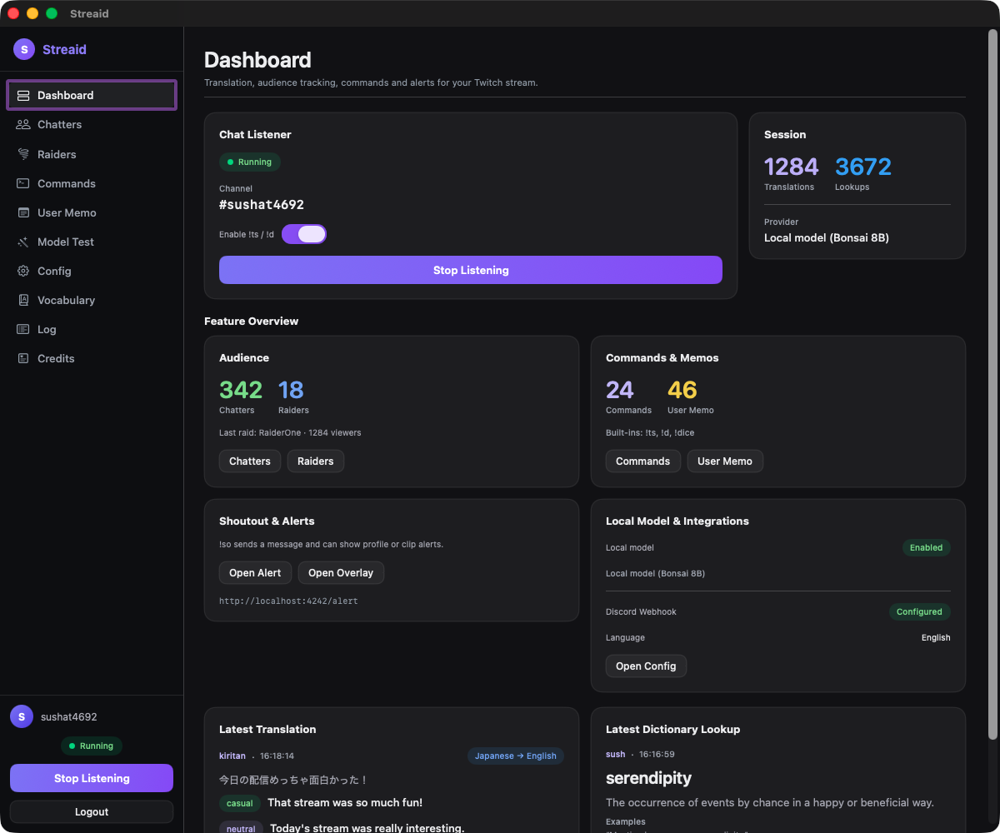

# Streaid

A native desktop app for Twitch streamers, currently available on macOS. It reads
chat to provide real-time Japanese ↔ English translation (`!ts`) and dictionary
lookup (`!d`), tracks chatters and raids, runs custom commands and user memos,
and powers shoutouts and OBS overlays. Translation and lookup use Gemini or the
optional on-device Bonsai model. The Rust core and JSON C ABI are UI-agnostic,
so other native frontends can be added later.

<p align="center">
  
</p>

The repository is a monorepo with a UI-agnostic Rust core and a native SwiftUI
frontend for macOS. Windows is a possible future direction (see `docs/future.md`),
but no Windows code is currently maintained.

## Repository layout

```
crates/streaid-core/   UI-agnostic Rust core (Twitch, Gemini, Bonsai, overlay, sounds)
crates/streaid-ffi/    C ABI (JSON) used by SwiftUI
apps/macos/            SwiftUI app (XcodeGen) + bridge + contract/UI tests
scripts/               build / package / Bonsai helpers
docs/                  developer documentation
```

## Features

- **`!ts`** — real-time Japanese ↔ English translation (3 formality levels + linguistic reasoning)
- **`!d`** — dictionary lookup (meaning, examples, synonyms)
- **Local model (Bonsai)** — optional on-device LLM provider (runs offline, no API key)
- **Chatters / Raiders** — first-message tracking, raid history, desktop notifications, 3 sound slots
- **Custom commands** — broadcaster/mod/vip/everyone permissions, `!dice`, management UI
- **User memos** — nickname and notes for chatters/streamers
- **Shoutouts** — `!so`, `!so user info`, `!so user clip`, `!stop`, plus UI buttons
- **OBS overlays** — translation/dictionary (`:4242/`) and shoutout alerts (`:4242/alert`)
- **Japanese / English UI** — runtime language switch, localized alerts/notifications
- **Discord Webhook** — post `!d` lookups as embeds
- OAuth2 device flow for Twitch, Gemini API key stored in the macOS Keychain
- Auto-reconnecting Twitch IRC connection (keepalive heartbeat, backoff, `RECONNECT` handling)

## Stack

Rust core (tokio-tungstenite / axum / reqwest / rodio / keyring) + SwiftUI on macOS 13+.

## Getting Started

Requirements: Xcode (xcodebuild + SwiftUI SDK) and a Rust toolchain.

```bash
# CLI: build the Rust core, build the app, ad-hoc sign, and launch
scripts/build-macos-app.sh --open

# or open the Xcode project and press ⌘R
open apps/macos/Streaid.xcodeproj
```

The Xcode target runs `scripts/build-core.sh` as a pre-build step, so the Rust
static library is always up to date.

Log in with your Twitch account (device flow), then open the Config page to set
your Gemini API key and start the chat listener.

## Development

- **Commands & conventions**: `AGENTS.md`
- **Architecture**: `docs/architecture.md`
- **FFI / JSON API**: `docs/ffi.md`
- **Migration history & remaining tasks**: `docs/native-ui-migration.md`
- **Feature details**: `docs/features.md`
- **Local model (Bonsai)**: `docs/bonsai.md`
- **Manual testing**: `docs/testing.md`
- **Future outlook (Windows)**: `docs/future.md`
- **Electron feature parity plan**: `docs/feature-parity-plan.md`
- **Changelog**: `CHANGELOG.md`
- **Legacy Tauri IPC reference**: `docs/legacy/tauri-commands.md`

## Local Model Setup (optional)

```bash
scripts/setup-bonsai.sh    # downloads the MLX runtime + Ternary-Bonsai-8B (~2.1 GB)
```

Then toggle "Enable Local Model" in Config. See `docs/bonsai.md`.

## Packaging (.app / .dmg)

```bash
scripts/package-macos.sh
# -> dist/macos/Streaid.app
# -> dist/macos/Streaid-<version>.dmg
```

For distribution, sign with a Developer ID certificate and notarize:

```bash
DEVELOPER_ID="Developer ID Application: ..." \
  NOTARY_PROFILE="streaid-notary" \
  scripts/package-macos.sh
```

The script uses hardened runtime, `notarytool`, and `stapler` when those
environment variables are set. See `packaging/README.md`.

## Disk Usage

Rust build artifacts live in `target/` (gitignored). To reclaim space:

```bash
scripts/clean-target.sh            # remove dev/test artifacts, keep release
scripts/clean-target.sh --release  # remove release artifacts, keep dev
scripts/clean-target.sh --all      # remove everything
```

`.cargo/config.toml` keeps debug info for our crates but disables it for
dependencies, which is where most of the disk usage came from.

## Tests & Checks

```bash
cargo test --workspace
cargo clippy --workspace --all-targets
cargo fmt --all --check

scripts/test-ffi-swift.sh          # Swift <-> Rust contract test
xcodebuild test \
  -project apps/macos/Streaid.xcodeproj \
  -scheme Streaid \
  -destination 'platform=macOS' \
  CODE_SIGN_IDENTITY="-" CODE_SIGNING_REQUIRED=NO
```

The app is arm64-only by decision (Intel support is not planned).
